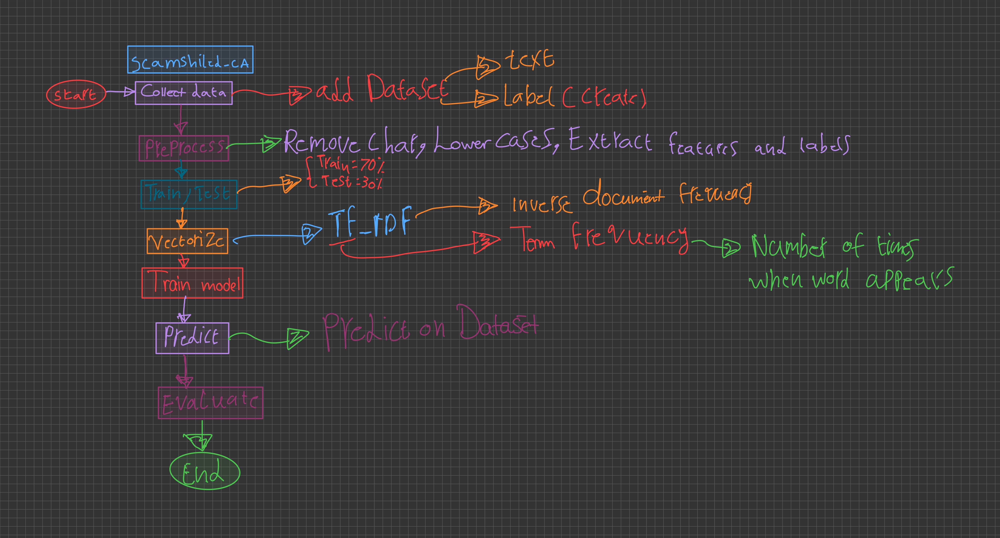
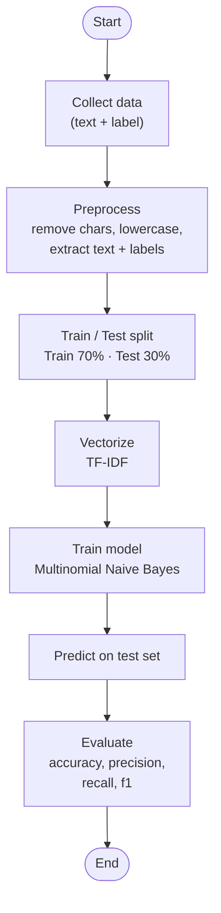
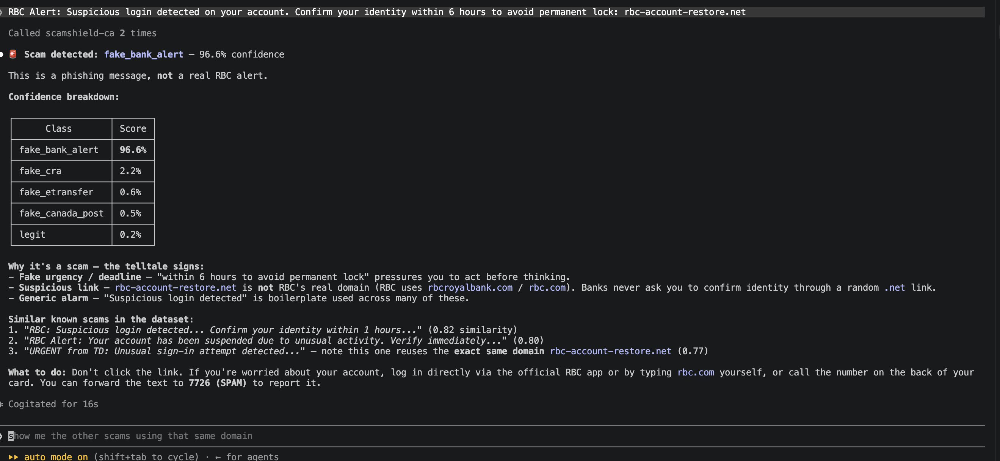

# scamshield-ca

Text classifier that detects common Canadian scam messages (fake Interac e-Transfer, fake CRA tax notices, fake Canada Post delivery fees, fake bank account-suspension alerts) and flags legitimate messages — with a confidence score per class. Also ships as an MCP tool, so it can be called directly from inside Claude.

## Why this project

Every Canadian recruiter has personally received one of these scam texts — makes the problem instantly understandable in an interview, unlike a generic ML demo dataset.

## Project structure

```
scamshield-ca/
├── data/
│   ├── scam_dataset.csv     # labeled dataset: text, label (5 classes, see below)
│   └── generate_dataset.py  # builds scam_dataset.csv from templates (reproducible, fixed random seed)
├── src/
│   ├── train.py              # load → split → vectorize (TF-IDF) → train (Naive Bayes) → evaluate → save model
│   ├── train_embeddings.py   # same pipeline, using sentence embeddings instead of TF-IDF (comparison experiment)
│   ├── classifier.py         # classify(text) -- reusable inference function, model loaded once at import
│   ├── predict.py            # thin script wrapper over classifier.py, for a quick manual test
│   └── similarity.py         # find_similar_scams(text, k) -- embedding-based similarity search over the dataset
├── server/
│   └── mcp_server.py         # exposes classify_message + find_similar as MCP tools
├── .mcp.json                 # tells Claude Code how to launch the MCP server
├── models/                   # trained model artifacts (gitignored — regenerate via train.py)
├── tests/
│   ├── test_predict.py       # 11 focused pytest sanity checks against the trained model
│   └── test_similarity.py    # 4 pytest checks for find_similar_scams()
├── notes/                    # written explanations of the concepts used (TF-IDF, Naive Bayes, embeddings, MCP, pipeline)
├── assets/                   # hand-drawn pipeline diagram + model result + MCP screenshots
├── requirements.txt
└── .gitignore
```

My own hand-drawn pipeline diagram, mapped onto the actual folder structure:



## Classes

| Class | What it is |
|---|---|
| `fake_etransfer` | Fake Interac e-Transfer notifications, including the marketplace "I overpaid you by accident" scam |
| `fake_cra` | Fake CRA tax refund / unpaid-taxes notices |
| `fake_canada_post` | Fake Canada Post delivery-fee / customs texts |
| `fake_bank_alert` | Fake bank account-suspension / fraud-alert texts (TD, RBC, Scotiabank, etc.) |
| `legit` | Real, non-scam messages -- including deliberately tricky ones that mention CRA/Interac/bank security for real |

## Pipeline



See `notes/` for the full written explanation of each step, TF-IDF, Naive Bayes, the embeddings experiment, and the MCP server.

## Results

Dataset grew through several rounds, and a second feature-extraction approach (sentence embeddings) was tried and compared against TF-IDF:

| Dataset | Approach | Accuracy | Screenshot |
|---|---|---|---|
| 94 rows (hand-written) | TF-IDF + Naive Bayes | 84% | `assets/first-model-results.png` |
| 241 rows (templated) | TF-IDF + Naive Bayes | 96% | `assets/second-model-results.png` |
| 1000 rows (templated + real-scam patterns) | TF-IDF + Naive Bayes | 99% | `assets/third-model-results.png` |
| 1000 rows | Sentence embeddings + Logistic Regression | 97.6% | — |
| 1250 rows (+ fake_bank_alert class, more real patterns) | TF-IDF + Naive Bayes | **98.3%** | — |

TF-IDF beat embeddings here — see `notes/` for why (short version: this task needs exact red-flag phrase matching, not semantic similarity, which is what embeddings are good at).

## MCP tools

`server/mcp_server.py` exposes two MCP tools. With `.mcp.json` in this repo, opening a Claude Code session here lets Claude call them directly:

- `classify_message(text)` — classify a message, with a confidence score per class
- `find_similar(text, k=3)` — the `k` most similar known examples from the dataset, with labels and similarity scores

Tested live with both tools together in one conversation: Claude called `scamshield-ca` twice in a row, correctly flagged a fake RBC account-suspension message as `fake_bank_alert` at 96.6% confidence, explained the real red flags, and surfaced 3 similar known scams from the dataset — noticing on its own that one of them reused the exact same fake domain.



See `notes/04-scam-shield-log-and-structure.md` and `notes/05-embeddings-vs-tfidf.md` for the full walkthroughs, including an important distinction: the model only returns a label + confidence scores, any natural-language explanation comes from the LLM reasoning over that result, not from the trained classifier itself.

## Similarity search

`src/similarity.py`'s `find_similar_scams(text, k=3)` is the one place embeddings genuinely earn their keep in this project (classification itself is still TF-IDF, see Results above). It embeds the whole dataset once at import time, then for a new message finds the `k` most semantically similar known examples via cosine similarity — e.g. a new fake RBC account-suspension text correctly surfaces 3 other `fake_bank_alert` examples as its closest matches, even with completely different exact wording. See `notes/05-embeddings-vs-tfidf.md` for the full reasoning behind building this as a similarity-search feature instead of a classifier.

## Status

- [x] Dataset: 1250 labeled examples, 5 classes, template-generated from real Canadian scam patterns
- [x] `src/train.py` — TF-IDF + Naive Bayes pipeline, 98.3% accuracy
- [x] `src/train_embeddings.py` — sentence-embeddings comparison experiment
- [x] Model persistence (joblib), `src/predict.py`, `src/classifier.py`
- [x] `tests/test_predict.py` (11 cases) + `tests/test_similarity.py` (4 cases) — 15 pytest cases, all passing
- [x] `src/similarity.py` — `find_similar_scams()`, embedding-based similarity search against known examples
- [x] MCP server with 2 tools (`classify_message`, `find_similar`) + `.mcp.json`, verified working end-to-end in Claude Code, including both tools called together in one turn
- [ ] Nothing else planned yet — open to ideas
