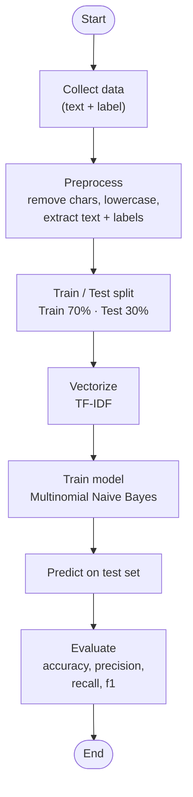

# Pipeline overview

This matches my own hand-drawn diagram in `assets/ProjectStructure.jpg`.



## Step by step

1. **Collect data** — raw text messages + their label (`fake_etransfer`, `fake_cra`, `fake_canada_post`, `legit`). Lives in `data/scam_dataset.csv`.
2. **Preprocess** — pull the `text` column and the `label` column out of the dataframe as two separate series. (Our dataset is already clean — no HTML, no weird encoding — so no extra cleanup needed here. A messier real-world dataset would also lowercase and strip punctuation at this step.)
3. **Train/Test split** — split into a training set (the model learns from this) and a test set (the model never sees this during training — it's the honest exam). We used `test_size=0.3` → 70% train, 30% test.
4. **Vectorize (TF-IDF)** — turn each text message into a row of numbers the model can actually do math on. See `02-tfidf-and-naive-bayes.md`.
5. **Train model (Naive Bayes)** — the model learns, from the training rows, which words tend to show up in which class.
6. **Predict** — run the trained model on the test set (and later, on brand-new messages it's never seen).
7. **Evaluate** — compare predictions against the real labels: accuracy, precision, recall, f1-score per class. See `03-dataset-and-results.md` for what these numbers actually looked like as the dataset grew.

## Why `fit_transform` on train but only `transform` on test

```python
X_train_vec = vectorizer.fit_transform(X_train)   # learns the vocabulary + converts
X_test_vec = vectorizer.transform(X_test)          # only converts, using what it already learned
```

If the vectorizer also "learned" from the test set, the model would get a sneak peek at words it's supposed to be tested on — that's data leakage, and it makes the evaluation numbers fake-optimistic. The vectorizer's vocabulary is frozen after `fit_transform` on train; `transform` on test just applies that same frozen vocabulary.

Related: [TF-IDF and Naive Bayes](02-tfidf-and-naive-bayes.md)
