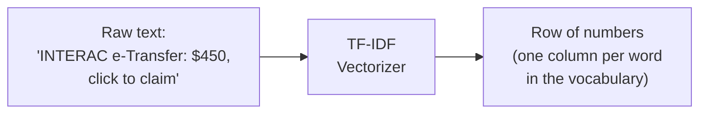

# TF-IDF and Naive Bayes

## TF-IDF — turning text into numbers

A model can't do math on the sentence `"You have received an Interac e-Transfer"` directly — it needs numbers. TF-IDF (Term Frequency – Inverse Document Frequency) converts every message into a row of numbers, one column per word in the whole dataset's vocabulary.

Two parts:

- **Term Frequency** — how many times a word shows up *in this one message*. A word repeated often in a single message gets a higher score for that message.
- **Inverse Document Frequency** — how rare that word is *across the whole dataset*. A word that appears in almost every message (like "the", "and", "to") gives you no information about which class it is — IDF pushes its score down. A word that only shows up in a handful of messages (like "etransfer-urgent-claim" or "CRA") is a strong signal — IDF pushes its score up.

TF-IDF = TF × IDF. High score = "this word is frequent here AND rare elsewhere" = informative.



In code:

```python
from sklearn.feature_extraction.text import TfidfVectorizer

vectorizer = TfidfVectorizer()
X_train_vec = vectorizer.fit_transform(X_train)   # learn vocabulary + convert
X_test_vec = vectorizer.transform(X_test)          # convert only (same vocabulary)
```

## Naive Bayes — deciding the class

Multinomial Naive Bayes is a probability-based classifier. For a new message, it asks: *"given the words in this message, which class was most likely to produce them?"*

It's called "naive" because it assumes every word's presence is independent of every other word in the message (which isn't really true — "Interac" and "e-Transfer" obviously show up together a lot) — but this simplification still works surprisingly well for text, and it's fast and cheap to train.

What it learns during training: for each class, how often each word appears in messages of that class. At prediction time, it multiplies together the probabilities of seeing each word in the new message, for each class, and picks the class with the highest combined probability.

```python
from sklearn.naive_bayes import MultinomialNB

model = MultinomialNB()
model.fit(X_train_vec, y_train)

predictions = model.predict(X_test_vec)
probabilities = model.predict_proba(X_test_vec)   # confidence per class
```

`predict_proba` is what gives us the per-class percentages (e.g. `92.6%` fake_etransfer) instead of just a flat yes/no answer — useful for a UI that wants to show "how sure" the model is, not just its final guess.

Related: [Pipeline overview](01-pipeline-overview.md) · [Dataset and results](03-dataset-and-results.md)
