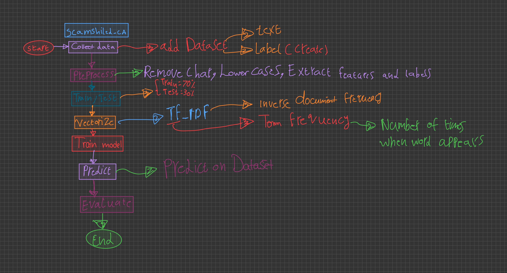
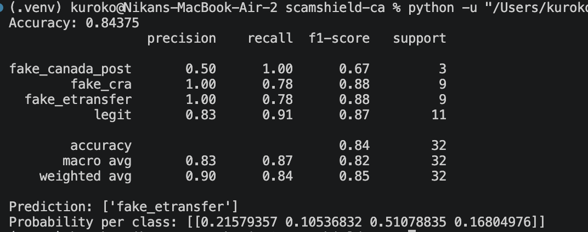
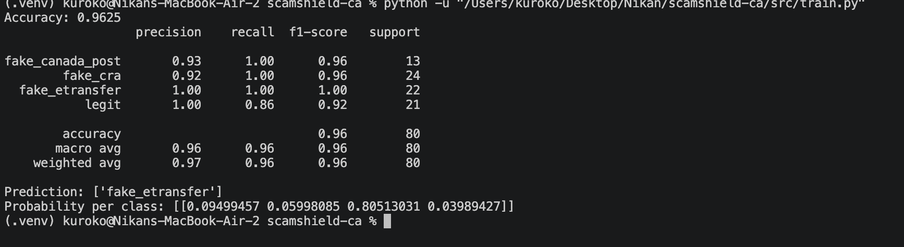
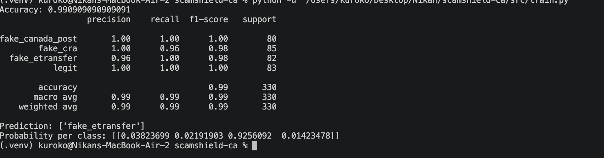
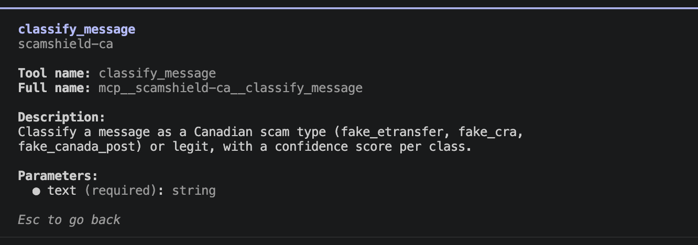
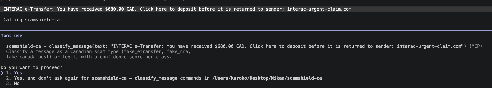
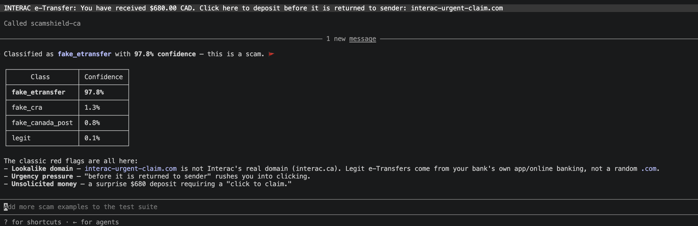

# Scam Shield — Log and Structure

## What this is

A text classifier that spots common Canadian scam messages — fake Interac e-Transfer notifications, fake CRA tax notices, fake Canada Post delivery-fee texts — and tells legit messages apart from them, with a confidence score per class. Picked this problem on purpose: every Canadian recruiter has personally gotten one of these scam texts, so it lands instantly in an interview instead of needing a generic ML-demo explanation.

## My own pipeline diagram

Drew this out by hand first to make sure I actually understood the flow before writing any code:



Collect data → Preprocess → Train/Test split (70/30) → Vectorize (TF-IDF) → Train model (Naive Bayes) → Predict → Evaluate. Every box in that drawing maps to a real line (or a few lines) in `src/train.py`.

## How the code maps to the diagram

```
data/scam_dataset.csv     — the labeled data (text, label)
data/generate_dataset.py  — builds the dataset from templates, fixed random seed so it's reproducible
src/train.py               — the full pipeline: load → split → TF-IDF → Naive Bayes → evaluate → save
src/predict.py              — (next) loads the saved model, classifies a new message
models/                     — trained model + vectorizer, saved with joblib
```

## TF-IDF, in one line

Turns a sentence into a row of numbers — words that repeat a lot *in one message* but are rare *across the whole dataset* (like "etransfer-urgent-claim" or a fake domain) get a high score, because they're the informative ones. Words everyone uses (the, and, to) get pushed down to near-zero.

## Naive Bayes, in one line

A probability model that, for each class, learned during training how often each word shows up in messages of that class. For a new message, it multiplies together the probability of seeing each of its words under each class, and picks whichever class comes out most likely. "Naive" because it pretends every word is independent of the others — not really true, but it still works well for text.

## The dataset's three versions

I didn't get to 99% accuracy on the first try — the dataset itself had to grow up:

**v1 — 94 rows, hand-written.** First pass, written mostly by hand with some realistic variety. Accuracy came out to 84%, and a new test message only got 51% confidence. The real problem showed up in the classification report: `fake_canada_post` only had 3 examples in the test set, so its precision/recall numbers were basically noise — one wrong guess there swings the percentage hugely.



**v2 — 241 rows, templated.** Instead of typing more sentences by hand, I built `generate_dataset.py`: a handful of message templates (`"{bank} e-Transfer: ${amt} received..."`) filled in with different banks, amounts, and fake domains, with a fixed `random_state=42` seed so it regenerates identically every time. Accuracy jumped to 96%, confidence on the same test message to 80.5%.



**v3 — 1000 rows, researched.** Searched real Canadian fraud-alert sources (CIBC's fraud-examples page, the CRA's own scam alerts, Canada Post's phishing guidance) and found the actual patterns scammers use — "reply INFO/YES/HELP" calls-to-action, a fake cashback-via-e-Transfer scam, "incomplete address, confirm here" Canada Post texts. Rebuilt the templates around those real patterns and scaled up to 250 rows per class (1000 total, perfectly balanced). Accuracy hit 99%, confidence on the same test message hit 92.6%.



## The one metric that tells the real story: `legit` recall

Across all three versions, `legit` was the class that struggled — not because legit messages are hard in general, but because I deliberately seeded some legit examples that *mention* "CRA" or "Interac" in a totally real way (e.g. "Your CRA Notice of Assessment is now available", "I just sent you $30 by Interac e-Transfer for dinner"). Those are the genuinely hard cases — a model that just pattern-matches on the word "CRA" would get them wrong every time.

- v1: `legit` recall = 0.86 (some of these tricky real messages got misclassified as scams)
- v3: `legit` recall = 1.00 (more real examples of this exact pattern taught the model the actual difference)

That's the clearest proof the dataset growth actually mattered, not just the raw accuracy number going up.

## predict.py and a focused test suite

Wrote `src/predict.py`: load the saved model + vectorizer with `joblib.load()`, `transform()` (not `fit_transform()`) a new message with that same vectorizer, then `model.predict()` + `model.predict_proba()` for the class and the confidence per class. Hit the same `os.path` relative-path bug a third time on the model/vectorizer paths and fixed it myself the same way as before.

The actual point of this step: understanding *why* you save a model at all. Without `joblib.dump`/`joblib.load`, classifying one new message means re-running the entire ~50-line training pipeline (load data, split, vectorize, train) every single time — train once, save to disk, then every future run just loads it. That clicked fully, not just the syntax.

Added `tests/test_predict.py` — 5 focused pytest cases (one obvious example per class, plus the genuinely hard case: a legit message that mentions "CRA" for real, not as a scam). All 5 pass. Deliberately kept it small — not a giant edge-case suite, just enough to catch a real regression if the model or dataset changes later.

## Turning it into an MCP server

Wanted the classifier to be usable directly inside Claude, not just from a script — so it needed to become an MCP tool. Two pieces:

**`src/classifier.py`** — pulled the inference logic out of `predict.py` into a reusable function so a long-running server process doesn't reload the model on every call. Model + vectorizer are loaded once at module level (outside any function); `classify(text)` just reuses them. Learned the hard way that `model.predict()` and `model.classes_` return `numpy` types (`np.str_`, `np.float64`), not plain Python `str`/`float` — harmless in a script, but breaks JSON serialization, which an MCP tool needs. Wrapped the label in `str(...)` and each confidence value in `float(...)`.

**`server/mcp_server.py`** — a thin wrapper using the `mcp` SDK (v2: `MCPServer`, not the older `FastMCP` name most tutorials still show). One tool, `classify_message`, registered with the `@mcp.tool()` decorator — first real use of a decorator in this project. The docstring on that function is what Claude actually reads to know what the tool does, so it has to describe it clearly, not just label it.

Smoke-tested by importing the module directly and calling `classify_message()` without starting the stdio server loop — confirmed it returns a clean, JSON-safe dict (`{'label': 'fake_cra', 'confidence': {...}}`).

**The import bug that only shows up when a script runs standalone:** `server/mcp_server.py` failed with `ModuleNotFoundError: No module named 'src'` the first time it ran through `.mcp.json`, even though the smoke test worked fine. Reason: running a script directly (`python3 server/mcp_server.py`) only adds that script's own folder (`server/`) to Python's import path, not the project root — unlike the smoke test, which imported the module from the project root so Python's own cwd-based path already covered it. Fixed by explicitly inserting the project root into `sys.path` at the top of `mcp_server.py`, using the same `script_dir` idea as before, one level up.

## Connected it to Claude Code — end to end, for real

After fixing the import bug, opened a fresh Claude Code session inside `~/Desktop/Nikan/scamshield-ca` (`.mcp.json` only loads at session start) and tested it live.



Claude found the tool automatically and showed its description (the docstring from `server/mcp_server.py`) and its one parameter (`text: string`).



Pasted a scam message and asked "is this a scam?" — Claude asked for approval before calling an MCP tool for the first time in this project, a real safety behavior, not something I had to build myself.



Result: `fake_etransfer` at 97.8% confidence, and underneath it Claude wrote out the actual red flags (lookalike domain, urgency pressure, unsolicited money).

**Important distinction — the model didn't write that explanation.** `classify()` only ever returns `{"label": ..., "confidence": {...}}` — a bare label and four numbers, nothing else. The red-flag explanation came from Claude itself, reasoning over that raw result with its own general knowledge, not from the Naive Bayes model. If someone asks in an interview "how does your model explain its reasoning?", the honest answer is: it doesn't — the trained model only classifies; any natural-language explanation is a separate LLM layer sitting on top of it. This is exactly the "stretch goal" explanation layer noted below, except it happened for free the moment the tool was wired into an LLM client, instead of needing to be coded by hand.

## The embeddings experiment, and a new scam class from real research

Wanted to compare TF-IDF against sentence embeddings, since this project now has both the RAG-embedding skill (from Nik-Blog Assistant) and a working classification baseline. Built `src/train_embeddings.py` as a parallel pipeline (same split, same seed, swap `TfidfVectorizer` → `SentenceTransformer.encode()`, swap `MultinomialNB` → `LogisticRegression` since Naive Bayes can't take negative numbers). Result: **97.6%**, slightly below TF-IDF's 99%. Full writeup of why in [`05-embeddings-vs-tfidf.md`](05-embeddings-vs-tfidf.md) — short version: this task needs exact red-flag phrase matching (TF-IDF's strength), not semantic topic similarity (embedding's strength), so the "simpler" method actually won. Real lesson, not a failed experiment — it's a legitimate interview answer about method selection, not just reporting the highest number.

Searched for more real Canadian scam patterns to push the dataset further: TD Bank's own warning about fake account-suspension texts, and RBC's writeup of the marketplace "I overpaid you by accident, send back the difference" e-Transfer scam. Added both — the overpayment pattern as new templates inside `fake_etransfer`, and a whole new class, `fake_bank_alert`, for account-suspension/fraud-alert scams (TD, RBC, Scotiabank, etc.). Also added a genuinely hard new `legit` case: a real bank sign-in notification that looks topically similar to `fake_bank_alert` but isn't asking for anything. Regenerated the dataset to **1250 rows, 5 classes, 250/class**. Re-ran `train.py` unchanged — still **98.3%** accuracy even with a 5th class and no weakening on `legit`. Added a 7th pytest case for the new class plus the new tricky `legit` case (both pass). Updated `README.md`, `notes/README.md`, and `server/mcp_server.py`'s docstring to reflect the new class.

## What's still open

- `find_similar_scams()` — an embedding-based similarity search against known examples, surfacing the closest past scam as supporting evidence. This is the one place embeddings genuinely help in this project (see `05-embeddings-vs-tfidf.md`), unlike classification itself.
- Stretch goal: build an explanation layer as an actual feature of the tool itself (e.g. `classify_message` returning its own red-flag reasoning, not relying on whatever LLM happens to be calling it) — reusing the Groq-call pattern from the Nik-Blog Assistant RAG chatbot

Related: [Pipeline overview](01-pipeline-overview.md) · [TF-IDF and Naive Bayes](02-tfidf-and-naive-bayes.md) · [Dataset and results](03-dataset-and-results.md)
