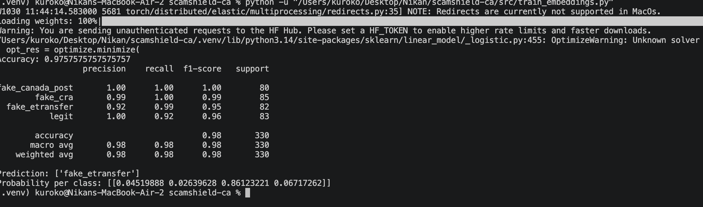
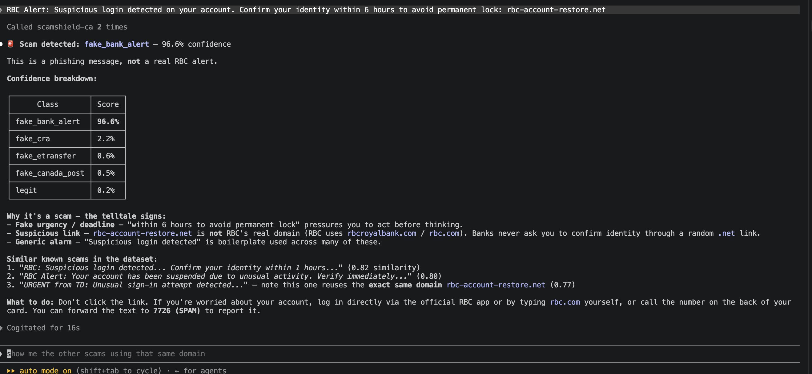

# Embeddings vs. TF-IDF — and why TF-IDF won here

## What a sentence embedding actually is

TF-IDF only knows exact words — "cancel" and "terminate" look like two completely unrelated tokens to it, because it's comparing character strings, not meaning. A **sentence embedding** fixes that: a pretrained model (`all-MiniLM-L6-v2`, the same model used for retrieval in the Nik-Blog Assistant RAG chatbot) reads a whole sentence and outputs a 384-number vector that represents its *meaning*. Sentences with similar meaning end up with vectors that are close together, even if they share almost no words.

```python
from sentence_transformers import SentenceTransformer
from sklearn.metrics.pairwise import cosine_similarity

model = SentenceTransformer("all-MiniLM-L6-v2")
sentences = ["I love my dog", "My puppy is the best", "The stock market crashed today"]
embeddings = model.encode(sentences)
cosine_similarity([embeddings[0]], [embeddings[1], embeddings[2]])
# sentence 0 and 1 (both about dogs, zero shared words) come out close
# sentence 0 and 2 (unrelated topics) come out far apart
```

## The experiment: swap TF-IDF for embeddings, keep everything else the same

`src/train_embeddings.py` uses the exact same pipeline as `src/train.py` (same data load, same `train_test_split`, same `random_state=42`) but replaces `TfidfVectorizer` with `SentenceTransformer.encode()`, and replaces `MultinomialNB` with `LogisticRegression` (Naive Bayes can't handle negative numbers, which embeddings produce; Logistic Regression can).

| Approach | Accuracy |
|---|---|
| TF-IDF + Naive Bayes | **99%** (on the 1000-row dataset) |
| Sentence embeddings + Logistic Regression | 97.6% |



## Why TF-IDF actually won

Looking at the per-class numbers, `legit` recall dropped from 1.00 (TF-IDF) to 0.92 (embeddings) — some real legit messages got misclassified as scams. The reason: an embedding captures *topic*, not *red-flag phrasing*. A legit message like "Your Interac e-Transfer to Sarah for $50 was successfully deposited" and a scam message like "INTERAC e-Transfer: $450 received, click to deposit" are about the *same topic* (Interac e-Transfer) — so their embeddings end up close together, even though one is completely safe and the other is a scam.

What actually separates them isn't the topic, it's exact red-flag phrases: "click here", "verify now", a suspicious domain, urgency language. TF-IDF is built exactly to catch literal recurring phrases like that. This task is **pattern/keyword detection** ("does this specific red-flag phrasing exist?"), not **semantic understanding** ("what is this message generally about?") -- and embeddings are built for the second kind of problem, not the first.

## Where embeddings do win (and already did, in another project)

- **Semantic search / RAG** (exactly what the Nik-Blog Assistant does): "does Nikan have banking experience?" needs to match against "LedgerLite — Digital Bank REST API" even though they share zero words.
- Recommendation systems, duplicate-question detection, clustering without labels, cross-lingual matching — anywhere the real question is "how similar in meaning are these two things?"

Rule of thumb: if the task is "how similar/related are these two texts in meaning" → embeddings. If the task is "does this exact pattern or phrase exist" → TF-IDF is usually enough, and here it was actually better.

## What this suggests as the next real use of embeddings in this project

Not classification (TF-IDF already wins that) -- but a **similarity-search feature**: given a new message, find the most similar known examples already in `data/scam_dataset.csv` using embeddings, and surface them as supporting evidence ("this looks like these 3 known fake_cra messages"). That's a genuinely good fit for embeddings, and reuses the same RAG-style retrieval skill from the Nik-Blog Assistant.

## `find_similar_scams()` -- built

`src/similarity.py` implements it: at module level (so it only runs once), load the dataset, encode the entire `text` column into one big batch of embeddings, and keep both the embeddings and the dataframe in memory. `find_similar_scams(text, k=3)` encodes the new message, runs `cosine_similarity` against every row's embedding, uses `np.argsort(...)[::-1][:k]` to get the indices of the top `k` most similar rows, and returns a list of `{"text", "label", "similarity"}` dicts.

Same unrelated-example-first teaching pattern as everything else in this project (a book-recommendation example this time: "a young mage battles dark forces" correctly matches a wizard-school book over a detective novel, with zero shared words). Writing the real version caught a few genuine mistakes along the way, each one a real lesson, not just a typo:

- **`text.encode()` vs `model.encode()`** -- these are two completely unrelated methods that happen to share a name. Python's built-in `str.encode()` converts a string to *bytes* (character encoding, e.g. UTF-8); `model.encode()` converts a string to a *semantic vector*. Calling the wrong one doesn't even error immediately in an obvious way -- it just silently does the wrong thing.
- **Hardcoding `top_k = 2` instead of using the function's own `k` parameter** -- meant the function would ignore whatever `k` the caller asked for.
- **`ValueError: Unsupported input type: Series`** -- passed `df["text"]` (a pandas Series) straight into `model.encode()`. `encode()` wants a plain Python list, not a Series -- the exact same lesson already learned once in `train_embeddings.py` with `.tolist()`, and this time self-diagnosed the instant it was flagged, a real sign the earlier lesson had actually landed, not just been copied.

Verified end to end: a new RBC account-suspension-style message correctly surfaces 3 other `fake_bank_alert` examples from the dataset as its closest matches (77-82% similarity), even though none of them share the exact same wording. `tests/test_similarity.py` (4 cases: result count, result shape, sorted-by-similarity, and that the closest matches are actually the same scam class) all pass.

## Wired up as a second MCP tool

Added `find_similar` to `server/mcp_server.py` alongside `classify_message`, wrapping `find_similar_scams`. One naming trap worth remembering: the tool function could *not* be named `find_similar_scams` like the imported function -- since both names would live in the same module, the tool definition would shadow the import, and calling it from inside itself would recurse forever instead of calling the real one. Named the tool `find_similar` instead.

Tested live with both tools together in one Claude Code conversation -- asked "is this a scam, and show me similar known examples":



Claude called `scamshield-ca` twice in a row (once per tool), correctly flagged the message as `fake_bank_alert` at 96.6% confidence, explained the real red flags (fake urgency, lookalike domain, generic alarm wording), and then listed 3 similar known scams from the dataset -- noticing on its own that one of them reused the *exact same* fake domain (`rbc-account-restore.net`) as the new message, a detail neither tool explicitly flagged, just something Claude picked up on by reading the retrieved results.

Related: [TF-IDF and Naive Bayes](02-tfidf-and-naive-bayes.md) · [Dataset and results](03-dataset-and-results.md)
